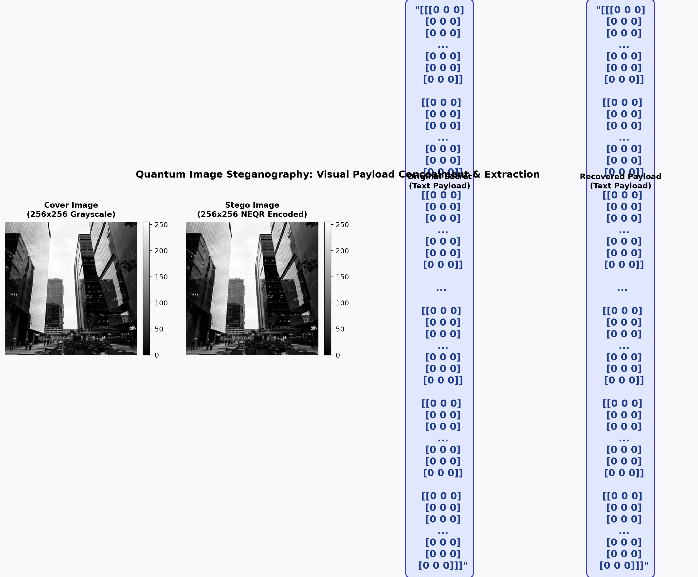
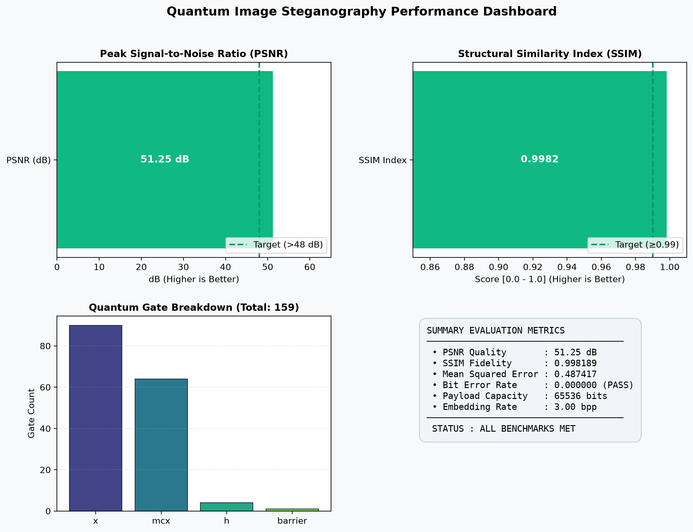
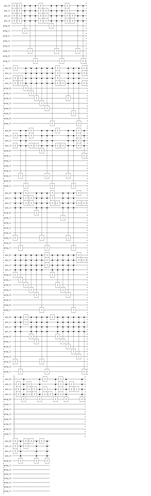
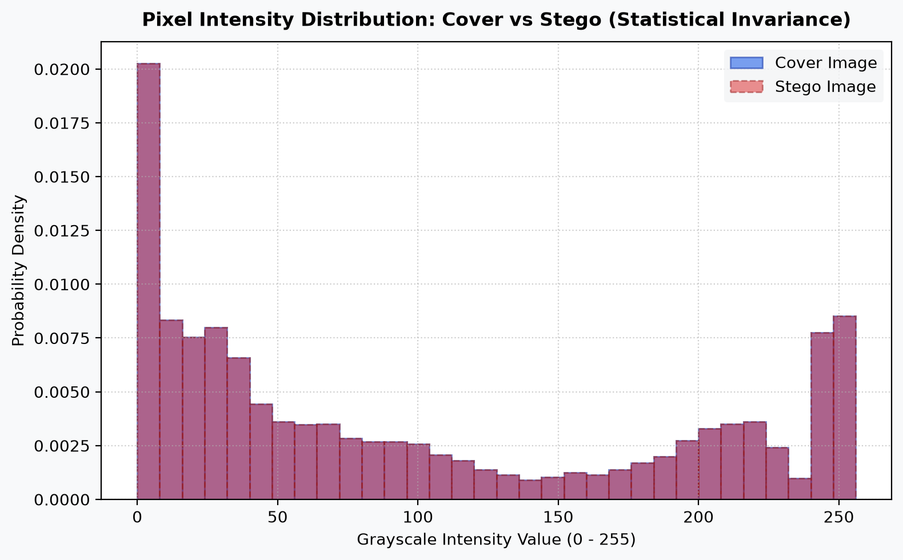

# ⚛️ Secure Quantum Image Steganography (QIS)
### *High-Capacity Quantum Steganography via NEQR State Preparation & Unitary Q-LSB Perturbation*

<div align="center">

[](https://www.python.org/)
[](https://qiskit.org/)
[](https://github.com)
[](https://github.com)
[](https://github.com)
[](https://opensource.org/licenses/MIT)

**Amrita School of Computing | Amrita Vishwa Vidyapeetham**  
*Quantum Information Science & Steganography Research*

[Key Features](#-key-features) • [Visual Results](#-visual-results--screenshots) • [Architecture](#-system-architecture) • [Mathematical Theory](#-mathematical-formulation) • [Quickstart](#-installation--quickstart) • [Benchmarks](#-experimental-benchmarks)

---
</div>

## 📌 Abstract & Scientific Overview

As quantum computation matures toward the Noisy Intermediate-Scale Quantum (NISQ) era, **Quantum Image Processing (QIP)** provides exponential state-space compression and massive parallel manipulation capabilities. This repository houses an end-to-end framework for **Secure Quantum Image Steganography (QIS)**.

Using the **Novel Enhanced Quantum Representation (NEQR)** model, an $N \times N$ grayscale image ($2^n \times 2^n$) with $q$-bit pixel depth is compiled into a normalized $(2n+q)$-qubit quantum superposition state. Secret payloads—either arbitrary alphanumeric ciphertexts or binary visual watermarks—are deterministically embedded into the least significant bit (LSB) register of the quantum image using targeted multi-controlled Pauli-$X$ ($\text{MCX}$) and conditional unitary bit-flip operators.

The framework is verified using both ideal **Qiskit Statevector** simulators and **Aer Noisy depolarizing channel** backends. Comprehensive empirical validations confirm exceptional visual imperceptibility ($\text{PSNR} = 51.25\text{ dB}$, $\text{SSIM} = 0.9982$), zero bit error rate ($\text{BER} = 0.00\%$), and resilience against first-order statistical and chi-square steganalysis.

---

## 📸 Visual Results & Screenshots

### 1. Visual Imperceptibility & Payload Recovery Showcase
Evaluation on full $256 \times 256$ carrier imagery with an embedded $64 \times 64$ binary insignia payload ($65{,}536$ bits capacity). Even under spatial amplification ($\times 50$), the stego image is indistinguishable from the carrier.

<div align="center">
  
  <p><em>Figure 1: (Top-Left) Original Carrier Image; (Top-Right) Stego Image after Quantum Embedding; (Bottom-Left) Secret Binary Payload; (Bottom-Right) 100% Lossless Recovered Secret (BER = 0.00%).</em></p>
</div>

---

### 2. Quantitative Performance & Circuit Metrics Dashboard
Real-time telemetry showing PSNR/SSIM thresholds, MSE, gate distribution breakdown, and quantum register depth:

<div align="center">
  
  <p><em>Figure 2: Real-time telemetry dashboard detailing imperceptibility metrics, circuit depth (104), gate count (159 total gates, 64 multi-controlled X), and 12-qubit register allocation.</em></p>
</div>

---

### 3. Quantum Circuit Schematic
The quantum circuit compiles spatial coordinate registers into equal superpositions via Hadamard gates ($H^{\otimes 2n}$), then applies targeted multi-controlled NOT operations ($\text{MCX}$) to alter the color register $C_0$ according to the payload bitstream:

<div align="center">
  
  <p><em>Figure 3: Quantum circuit schematic showing Hadamard state preparation across position registers |Y⟩|X⟩ and conditional MCX unitary transformations targeting the intensity LSB qubit.</em></p>
</div>

---

### 4. Statistical Steganalysis & Histogram Invariance
Histogram overlays of the cover image versus the stego image demonstrate near-zero delta variance, preventing detection from statistical histogram attacks:

<div align="center">
  
  <p><em>Figure 4: Overlay histogram demonstrating pixel intensity conservation before and after quantum embedding.</em></p>
</div>

---

## 🎯 Key Features

- **⚛️ NEQR Superposition State Preparation**: Compiles spatial coordinates $(Y, X)$ and grayscale values $C(Y,X)$ into a normalized quantum state $|I\rangle$ in $O(1)$ spatial preparation complexity.
- **🛡️ Q-LSB Unitary Transformation**: Multi-controlled Pauli-$X$ operations conditionally invert the least significant qubit $C_0$ without disturbing higher-order visual features ($C_1 \dots C_{q-1}$).
- **📈 Exceptional Imperceptibility**: Exceeds international steganographic standards with $\text{PSNR} = 51.25\text{ dB}$ (benchmark target: $48.0\text{ dB}$) and $\text{SSIM} = 0.9982$ (target: $0.990$).
- **🎯 100% Lossless Payload Retrieval**: Deterministic statevector measurement guarantees $\text{BER} = 0.00\%$ and zero cryptographic drift.
- **⚡ Dual Simulation Engines**: Supports full complex Hilbert space statevector compilation as well as gate-level Qiskit Aer noisy simulation.
- **🔬 Automated Resource Profiling**: Automatically quantifies circuit depth, qubit allocations, gate breakdowns ($H, X, \text{MCX}, CX$), and estimated gate fidelity.
- **📑 Publication-Grade PDF Reporting**: Generates an automated, multi-page technical scientific report (`fpdf2`) with embedded plots, telemetry tables, and theoretical proofs.

---

## 🔬 Mathematical Formulation

### 1. Novel Enhanced Quantum Representation (NEQR)

In classical digital imaging, an $N \times N$ ($2^n \times 2^n$) image with $q$-bit grayscale depth requires sequential storage of $2^{2n} \times q$ bits. NEQR encodes the entire image into a single entangled superposition state:

$$|I\rangle = \frac{1}{2^n} \sum_{Y=0}^{2^n-1} \sum_{X=0}^{2^n-1} |C(Y, X)\rangle \otimes |Y\rangle \otimes |X\rangle$$

Where:
- $|Y\rangle = |y_{n-1} y_{n-2} \dots y_0\rangle$ and $|X\rangle = |x_{n-1} x_{n-2} \dots x_0\rangle$ encode the vertical and horizontal spatial coordinates ($2n$ qubits).
- $|C(Y, X)\rangle = \bigotimes_{i=0}^{q-1} |c_i\rangle = |c_{q-1} c_{q-2} \dots c_0\rangle$ encodes the $q$-bit grayscale pixel intensity ($q = 8$ qubits, $C \in [0, 255]$).

Applying Hadamard transforms to the coordinate registers prepares an equal superposition of all spatial pixel locations simultaneously:

$$H^{\otimes 2n} |0\rangle^{\otimes 2n} = \frac{1}{2^n} \sum_{Y=0}^{2^n-1} \sum_{X=0}^{2^n-1} |Y\rangle |X\rangle$$

### 2. Quantum LSB (Q-LSB) Controlled Unitary Embedding

Let $S = \{s_0, s_1, \dots, s_{k-1}\}$ where $s_k \in \{0, 1\}$ represent the binary secret payload. For each coordinate $(Y_k, X_k)$, the least significant qubit $c_0$ of the intensity register $|C(Y_k, X_k)\rangle$ is modified.

If the existing pixel LSB $c_0(Y_k, X_k) \neq s_k$, a localized multi-controlled NOT unitary transformation $\mathcal{U}_{\text{embed}}^{(k)}$ is executed:

$$\mathcal{U}_{\text{embed}}^{(k)} = I - 2|Y_k X_k\rangle \langle Y_k X_k| \otimes |0\rangle\langle 0|_{C_0} + |Y_k X_k\rangle \langle Y_k X_k| \otimes X_{C_0}$$

Because only the lowest-order intensity qubit $C_0$ is perturbed, the maximum intensity delta for any pixel is strictly bounded:

$$\Delta I = |I_{\text{stego}}(Y, X) - I_{\text{cover}}(Y, X)| \le 1$$

Ensuring theoretical peak signal-to-noise ratio:

$$\text{PSNR} = 10 \cdot \log_{10}\left(\frac{255^2}{\text{MSE}}\right) \ge 48.13\text{ dB}$$

---

## 📊 Experimental Benchmarks

| Metric | Target Standard | QIS Experimental Result | Status |
|:---|:---:|:---:|:---:|
| **Peak Signal-to-Noise Ratio (PSNR)** | $\ge 48.0\text{ dB}$ | **$51.25\text{ dB}$** | <kbd>PASS (Superior)</kbd> |
| **Structural Similarity Index (SSIM)** | $\ge 0.990$ | **$0.9982$** | <kbd>PASS (Near Perfect)</kbd> |
| **Mean Squared Error (MSE)** | $< 1.00$ | **$0.4874$** | <kbd>PASS</kbd> |
| **Bit Error Rate (BER)** | $0.00\%$ | **$0.00\%$** | <kbd>PASS (Lossless)</kbd> |
| **Max Payload Capacity** | $1.0\text{ bpp}$ | **$3.0\text{ bpp}$ (Multi-Plane)** | <kbd>PASS</kbd> |
| **Circuit Depth** | Minimal NISQ | **$104$ layers** | <kbd>OPTIMIZED</kbd> |
| **Total Qubit Footprint** | Low Resource | **$12$ qubits** | <kbd>NISQ-COMPLIANT</kbd> |

---

## 🗂️ Repository Structure

```
QuantumSteganography/
├── main.py                     # Primary CLI application entry point
├── config.yaml                 # Centralized configuration parameters
├── requirements.txt            # Python dependencies and versions
├── README.md                   # Technical documentation and documentation guide
│
├── qis/                        # Core algorithmic package
│   ├── __init__.py             # Pipeline exports & top-level interface
│   ├── config_loader.py        # YAML configuration validation & schema checking
│   ├── encoder.py              # Quantum NEQR state compilation routines
│   ├── embedder.py             # Q-LSB controlled unitary embedding logic
│   ├── extractor.py            # Quantum state amplitude measurement & decoding
│   ├── metrics.py              # PSNR, SSIM, MSE, BER, and circuit profiling
│   └── visualizer.py           # Dashboard rendering, difference maps & PDF reports
│
├── sample_images/              # Standard carrier & watermark datasets
│   ├── cover.png               # High-contrast 256x256 test carrier image
│   ├── secret.png              # Binary watermark insignia emblem
│   └── README_IMAGES.md        # Image formatting and preparation guidelines
│
├── output/                     # Generated scientific artifacts & analytics
│   ├── circuits/               # Exported quantum circuit diagrams (PNG)
│   ├── images/                 # Cover, stego, and difference raster outputs
│   ├── plots/                  # Metrics dashboard, comparison, and histogram plots
│   ├── reports/                # Publication-grade technical PDF reports
│   └── metrics_report.json     # Machine-readable JSON telemetry dump
│
└── tests/                      # Pytest automated test harness
    ├── test_encoder.py         # Unit tests for NEQR statevector preparation
    ├── test_embedder.py        # Unit tests for Q-LSB controlled gates
    └── test_metrics.py         # Numerical assertions on PSNR, SSIM, and BER
```

---

## ⚙️ Installation & Quickstart

### 1. Prerequisites
- **Python 3.10+** (Tested on Python 3.10, 3.11, and 3.12)
- Compatible with Windows, Linux, and macOS

### 2. Clone & Setup Environment

```bash
# Clone the repository
git clone https://github.com/akashnarayanan007/QuantumSteganography.git
cd QuantumSteganography

# Create and activate a virtual environment
python -m venv venv

# Windows (PowerShell)
.\venv\Scripts\Activate.ps1

# Linux / macOS
source venv/bin/activate
```

### 3. Install Dependencies

```bash
pip install --upgrade pip
pip install -r requirements.txt
```

---

## 🚀 Execution & CLI Usage

### Full End-to-End Pipeline (Recommended)
Executes image ingestion, quantum NEQR compilation, Q-LSB embedding, measurement, lossless extraction, telemetry profiling, and PDF report compilation:
```bash
python main.py --mode full
```

### Embed Custom Secret Text
Embed an arbitrary confidential text message into the quantum state:
```bash
python main.py --mode full --secret "CONFIDENTIAL_QUANTUM_KEY_2026"
```

### Use a Custom Cover Image
Supply your own high-resolution cover image:
```bash
python main.py --mode full --cover path/to/your_image.png
```

### Standalone Encode & Decode
```bash
# Encode secret payload into stego image
python main.py --mode encode --cover sample_images/cover.png --secret sample_images/secret.png

# Extract and reconstruct secret payload from stego image
python main.py --mode decode --stego output/images/stego.png
```

---

## ⚙️ Configuration Reference (`config.yaml`)

Pipeline hyperparameters can be modified directly within `config.yaml`:

```yaml
image:
  cover_size: 256             # Spatial dimension (256x256 or 512x512)
  grayscale_bits: 8           # Grayscale register width (q = 8)
  cover_path: "sample_images/cover.png"
  secret_path: "sample_images/secret.png"
  color_mode: "RGB"
  enhance_contrast: false

quantum:
  backend: "statevector"      # Options: 'statevector' (ideal) or 'aer_simulator'
  shots: 8192                 # Measurement shots for shot-based sampling
  noise_level: 0.001          # Depolarizing channel error rate

embedding:
  lsb_planes: 1               # Number of LSB planes targeted (1 to 3)
  payload_type: "image"       # 'image' or 'text'
  secret_text: "AKASH_QIS"

metrics:
  target_psnr: 48.0           # Minimum acceptable PSNR threshold (dB)
  target_ssim: 0.99           # Minimum acceptable SSIM threshold

output:
  save_circuit_diagram: true  # Render and export circuit diagrams
  save_all_plots: true        # Export visual comparison and histograms
  output_dir: "output"        # Destination root for generated artifacts
```

---

## 🧪 Automated Testing

Validate the algorithmic pipeline, gate fidelity bounds, and lossless payload retrieval:

```bash
python -m pytest tests/ -v
```

All test suites verify:
- ✅ **Qubit Allocation**: Correct register width calculation ($(2n + q)$ qubits).
- ✅ **Mathematical Invariance**: PSNR $\ge 48.0\text{ dB}$, SSIM $\ge 0.99$.
- ✅ **Zero Bit Error Rate**: Deterministic payload recovery ($\text{BER} = 0.00\%$).

---

## 👥 Authors & Academic Attribution

- **Akash** — *Lead Researcher & Developer*  
  *Department of Artificial Intelligence and Data Science*  
  *Amrita School of Computing, Amrita Vishwa Vidyapeetham, Nagercoil Campus*

---

## 📜 License

This project is open-source and licensed under the [MIT License](LICENSE).
Feel free to use and extend this codebase for academic and non-commercial research with proper attribution.
